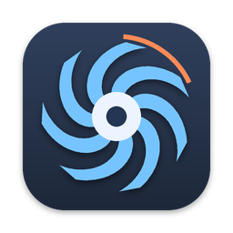

<p align="center"></p>

<h1 align="center">OpenFan</h1>

<p align="center">Open-source fan control for Intel and Apple Silicon Macs. One edition, every feature, no restrictions.</p>

<p align="center">
  <a href="https://github.com/murtaza1905/OpenFan/actions/workflows/ci.yml"></a>
  <a href="https://github.com/murtaza1905/OpenFan/releases/latest"></a>
  <a href="LICENSE"></a>
  
  
</p>

OpenFan runs as a regular app with a window and a menu bar item (the Dock icon can be turned off in Settings). The menu bar item shows the temperature and fan speed you choose and lets you take control of each fan individually. Written from scratch in Swift and SwiftUI with a small C layer for the SMC.

<!-- Screenshots: add images to docs/screenshots/ and reference them here. -->

## Features

- **Auto** — the system decides (default)
- **Constant RPM** — pin a fan to a fixed speed
- **Sensor-based** — a fan follows a temperature sensor of your choice with a linear curve between a minimum and a maximum temperature
- **Presets** — save complete fan configurations, apply them from the menu bar, apply one automatically at launch
- **Sensors** — every temperature sensor the SMC exposes, with readable names
- **Menu bar** — live temperature and fan speed of your choice; the main window is one click away
- **Localized** — English and Turkish, following the system language
- **Safety** — fans return to automatic control when the app quits or loses the helper, and targets are always clamped to the fan's hardware range

## Requirements

- macOS 13 Ventura or later
- Intel or Apple Silicon (one universal binary)
- Xcode 15 or later, only if you build from source — the prebuilt release needs nothing

## Install

### Download

1. Get `OpenFan-<version>.dmg` from the [latest release](https://github.com/murtaza1905/OpenFan/releases/latest) and drag **OpenFan.app** to **Applications**. The app must stay in `/Applications`: the privileged helper is registered from the app's location.
2. The app is ad-hoc signed, not notarized. On first launch right-click the app › **Open**. If macOS reports the app as damaged, run:

   ```bash
   xattr -dr com.apple.quarantine /Applications/OpenFan.app
   ```

3. Every release ships `SHA256SUMS.txt`; verify with `shasum -a 256 -c SHA256SUMS.txt --ignore-missing`.

### Build from source

Only Xcode is required. XcodeGen is downloaded automatically when it is not installed; Homebrew is not needed.

```bash
git clone https://github.com/murtaza1905/OpenFan.git
cd OpenFan
./scripts/install.sh
```

The script generates the Xcode project, builds a universal Release app, installs it to `/Applications` and launches it. Run the same command again to update.

```bash
./scripts/build.sh        # build only → build/OpenFan.app
./scripts/install.sh      # build, install to /Applications, launch
./scripts/make-dmg.sh     # build and package → dist/OpenFan-<version>.dmg
./scripts/uninstall.sh    # remove the app, the helper, settings and presets
```

To work in Xcode: run `./scripts/build.sh` once (or `xcodegen generate`), then open `OpenFan.xcodeproj` and run the `OpenFan` scheme. Ad-hoc signing is configured, so no Apple Developer account is needed; if you have a team, set `DEVELOPMENT_TEAM` in `project.yml`.

## First run

Reading temperatures and fan speeds never needs the helper; only changing fan speeds does.

1. Launch OpenFan. The main window opens and a menu bar item appears.
2. **Settings → Install helper**.
3. macOS asks you to allow the background item: **System Settings → General → Login Items & Extensions**, enable **OpenFan**.
4. Back in OpenFan, click **Refresh**. Status should read *Installed and running*.

Upgrading from 1.3.x? The helper changed its name in 1.4.0. Remove the old one once with `sudo launchctl bootout system/com.openfan.helper`, then install the helper again as above. Settings and presets carry over automatically.

## Usage

- **Fans** tab — pick Auto, Constant RPM or Sensor-based per fan; the current and target speeds are shown live.
- **Sensors** tab — every SMC temperature sensor; *Show all sensors* reveals the raw key variants, *Copy list* copies the readings for a bug report.
- **Presets** tab — save the current configuration, apply a preset later from the menu bar, or choose one to apply at launch.
- **Settings** tab — helper status, launch at login, Dock icon, menu bar readout, polling interval, About.
- **Menu bar** — temperature and fan speed at a glance, presets, *All fans to Auto*, the main window and *About OpenFan…*.

## How it works

- **Reading** — `AppleSMC` is opened via IOKit from the app process. Fan keys are `FNum`, `F<n>Ac` (actual), `F<n>Tg` (target), `F<n>Mn` / `F<n>Mx` (range), `F<n>Md` (mode), `F<n>ID` (name). Temperature sensors are discovered by enumerating all SMC keys starting with `T` whose type is `flt` or `sp78`-style and whose value is plausible.
- **Writing** — fan targets require root. `openfan-helper` is a launchd daemon registered with `SMAppService` and reached over XPC. The helper validates the fan index, clamps the target to the hardware range, switches the fan to manual mode and writes the target.
  - Apple Silicon and newer Intel Macs: `F<n>Md = 1` then `F<n>Tg` (float)
  - Older Intel Macs: set bit *n* in `FS!` then `F<n>Tg` (fpe2)
- **Control loop** — the app polls every 1–30 s, computes each fan's target from its mode and resends when the target moves more than 20 rpm or every 30 s.

### Sensors

Apple Silicon Macs expose many SMC temperature keys. OpenFan groups them by category and, by default, shows one reading per sensor family: keys that differ only in an `a` / `b` / `x` / `z` suffix are variants of the same measurement point, and the `z` variant (highest, most responsive) is shown. *Show all sensors* reveals every key. Apple does not document these keys; the names OpenFan assigns to undocumented ones (SoC zones, thermal zones, skin sensors, virtual sensors) are descriptive labels, not official designations. `TCMz`, where present, is the maximum of the CPU die sensors and is used as the default CPU reading.

## Privacy

OpenFan has no network access, no analytics and no accounts. Fan modes, presets and settings live in its own user defaults; sensor readings stay in memory. See [PRIVACY.md](PRIVACY.md).

## Troubleshooting

- **Helper status "Not found"** — the plist or helper binary is missing from the bundle. Rebuild; check `OpenFan.app/Contents/Library/LaunchDaemons/` and `Contents/MacOS/openfan-helper`.
- **Status stays "Waiting for approval"** — approve the item in Login Items & Extensions, then click Refresh. If it was approved before but the app moved, click Remove helper, move the app back, Install helper again.
- **Fan does not change speed** — check the Fans tab for an error line. Run `log stream --predicate 'subsystem == "com.muratonurcu.OpenFan.helper"'` in Terminal to see helper errors.
- **Helper not responding after an app update** — Remove helper, then Install helper again.
- **No fans** — some Macs (MacBook Air M1/M2) have no fans; sensors still work.

## Project layout

```
project.yml                                XcodeGen project definition (version, bundle IDs, targets)
Sources/SMC/                               C: AppleSMC IOKit access
Sources/Shared/                            Swift: SMC wrapper + codec, XPC protocol (both targets)
Sources/openfan-helper/                    Privileged launchd daemon (fan writes)
Sources/OpenFan/                           App: SwiftUI views, models, helper client, AboutPanel, Localizable.xcstrings
Resources/com.muratonurcu.OpenFan.helper.plist   launchd plist embedded in the app bundle
Resources/PrivacyInfo.xcprivacy            Privacy manifest
scripts/                                   build.sh · install.sh · make-dmg.sh · uninstall.sh
.github/workflows/                         ci.yml (build check) · release.yml (tag → DMG + ZIP + checksums → GitHub Release)
docs/                                      README assets
```

## Development

- Build check on every push and pull request: [CI](https://github.com/murtaza1905/OpenFan/actions/workflows/ci.yml).
- Releases are produced by the [Release workflow](.github/workflows/release.yml) from a `v*` tag; see [CONTRIBUTING.md](CONTRIBUTING.md) for the exact steps.
- Changes are tracked in [CHANGELOG.md](CHANGELOG.md).

## Security notes

The helper accepts any local XPC client that can reach its Mach service. It only ever writes fan keys for valid fan indices within the hardware range, so the worst case is a fan speed change. Adding a code-signing requirement on the connection (`NSXPCConnection.setCodeSigningRequirement`) is the planned hardening once builds are signed with a Developer ID. See [SECURITY.md](SECURITY.md) for how to report a problem.

## Contributing and support

- Bugs and feature ideas: [Issues](https://github.com/murtaza1905/OpenFan/issues) (templates are provided).
- Pull requests are welcome — see [CONTRIBUTING.md](CONTRIBUTING.md).
- Security problems: see [SECURITY.md](SECURITY.md) — please do not open a public issue.

## License

OpenFan is released under the [MIT License](LICENSE). It contains no third-party code.

## Author

Murat Onurcu — [muratonurcu@outlook.com](mailto:muratonurcu@outlook.com)
